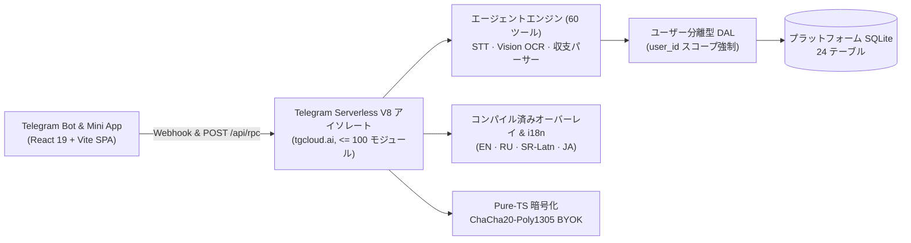

[English](README.md) | [Русский](README.ru.md) | [Srpski](README.sr.md) | **日本語**

# Tokio

[](LICENSE)
[](tsconfig.json)
[](https://tgcloud.ai/)
[](src/lib/db/tables.ts)
[](miniapp/)
[](locales/)
[](tests/)

**Tokio** は、**Telegram Serverless**（`tgcloud.ai`）向けにネイティブ設計されたオープンソースのパーソナル AI アシスタントコアです。24 テーブルの組み込み SQLite を備えた V8 アイソレート上で動作し、5 タブ構成の **React 19 Telegram Mini App** と**標準 4 言語**（`EN`、`RU`、`SR-Latn`、`JA`）に対応し、**宣言的 Level 1 オーバーレイ**によって共通コアと個別設定を明確に分離します。

> [!TIP]
> **クローン直後から動作します：** 独自の `overlay/` フォルダがない場合、Tokio は自動的に [`example/overlay/`](example/overlay/) へフォールバックし、多言語デモデータ（[`example/seed/demo.json`](example/seed/demo.json)）を備えた完全なアシスタントとしてビルドできます。

---

## アーキテクチャ



ランタイムとモジュール構成の詳細は [`docs/system/ARCHITECTURE.md`](docs/system/ARCHITECTURE.md) および [`docs/system/OVERLAY-SPEC.md`](docs/system/OVERLAY-SPEC.md) をご覧ください。

---

## 主な特徴

- **単一ソースの SQLite スキーマ（`24` テーブル）**：[`src/lib/db/tables.ts`](src/lib/db/tables.ts) で一元定義し、`tgcloud migrate` 用のプラットフォーム DSL（`src/schema.ts`）と Vitest ローカルテスト用の SQL DDL（`src/lib/db/ddl.ts`）の双方へ出力します。
- **宣言的 Level 1 オーバーレイとランタイムスキル**：プロンプト、口調スタイル、手順書 `skills/*.md`、口座エイリアス、機能フラグ、Mini App テーマを `.gitignore` 対象の `overlay/` または `OVERLAY_DIR` に分離して管理できます。詳細は [`example/README.ja.md`](example/README.ja.md) をご参照ください。
- **4 言語サポート（`EN`、`RU`、`SR-Latn`、`JA`）**：ボット応答、キーボード、オンボーディングウィザード、プロンプト、Mini App UI、初期デモデータ（`locales/*.json` + `miniapp/src/i18n/`）をすべて 4 言語で提供します。
- **60 種類のネイティブエージェントツール**：タスクとカレンダー予定（`item_type: 'task' | 'event'`）、多通貨家計簿と債務管理、メモとナレッジグラフ、服薬管理、ランウェイ予測、インボックストリアージ、日記、スキル管理（`list_skills`・`read_skill`・`draft_skill`）、ゴミ箱復元を網羅しています。
- **決定論的収支パーサーと即時取り消し**：テキスト、音声（STT）、レシート・残高スクリーンショットから支出・収入・振替・残高を解析し、ワンタップまたは `/undo` で即座に取り消せます。
- **Pure-TS ChaCha20-Poly1305 BYOK 暗号化**：ネイティブ C++ 依存ゼロで動作し、暗号化されたユーザー自身の Gemini API キー登録（BYOK）や利用上限・アクセス制御モードに対応します。
- **3 層の情報漏洩防止**：`overlay/` と `.forbidden-strings.local` を `.gitignore` で除外し、`.githooks/pre-push` と `scripts/check-leaks.mjs` がファイルと git 履歴を検査し、CI が全プッシュ・PR で `gitleaks` と漏洩チェックを実行します。

---

## クイックスタート

### 動作環境

- **Node.js 22+** および `npm`
- 任意：ローカル push 前スキャン用の `gitleaks`（`brew install gitleaks`）
- 任意：デプロイ用の `@tgcloud/cli` トークン（BotFather の `Serverless -> CLI Access`）

### 1. クローンとインストール

```bash
git clone https://github.com/ValDagon/tokio.git
cd tokio
npm install
(cd miniapp && npm install)
```

`npm install` により `git config core.hooksPath .githooks` が設定され、`git push` の前に漏洩チェックが自動実行されます。

### 2. ローカル検証（追加設定不要）

プライベートオーバーレイを用意しなくても、Tokio は自動的に [`example/overlay/`](example/overlay/) をコンパイルし、インメモリ SQLite 上ですべての検証を実行できます：

```bash
npm run check:leaks
npm run typecheck
npm test
npm run build

cd miniapp
npm run lint
npm test
npm run build -- --outDir ../miniapp-dist --emptyOutDir
```

### 3. Telegram Serverless（`tgcloud.ai`）へのデプロイ

```bash
npx tgcloud push && npx tgcloud migrate --yes
```

または検証・ビルド込みのデプロイスクリプトを使用できます：

```bash
APP_URL=https://<your-app>.tgcloud.ai ./.agents/scripts/deploy.sh
```

---

## オーバーレイによるカスタマイズ

コアのソースコードを変更せずにブランド名、プロンプト、財務・通貨の初期設定、機能フラグなどを調整するには：

1. サンプルを `.gitignore` 対象の `overlay/` へコピーします：
   ```bash
   cp -R example/overlay overlay
   ```
2. `overlay/manifest.json` と `overlay/prompts/{ru,en,sr,ja}/*.md` を編集します。
3. 再ビルドしてデプロイします（`npm run build`、または外部パスを `OVERLAY_DIR=/path/to/overlay` で指定）。

詳しい手順は [`example/README.ja.md`](example/README.ja.md) および [`docs/system/OVERLAY-SPEC.md`](docs/system/OVERLAY-SPEC.md) をご覧ください。

---

## コントリビュート・セキュリティ・ライセンス

- **コントリビュート**：Core と Overlay の境界ルールおよび検証手順は [`CONTRIBUTING.ja.md`](CONTRIBUTING.ja.md) と [`AGENTS.md`](AGENTS.md) をご確認ください。
- **セキュリティ**：脆弱性の報告は公開 Issue ではなく [GitHub Security Advisories](https://github.com/ValDagon/tokio/security/advisories) から非公開で行ってください。詳細は [`SECURITY.ja.md`](SECURITY.ja.md) に記載しています。
- **著者・貢献者**：[`CONTRIBUTORS.md`](CONTRIBUTORS.md) および [`NOTICE`](NOTICE) をご覧ください。
- **ライセンス**：[Apache License, Version 2.0](LICENSE) のもとで公開されています。
