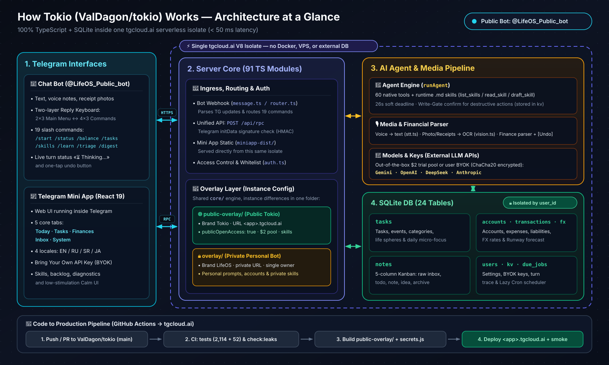
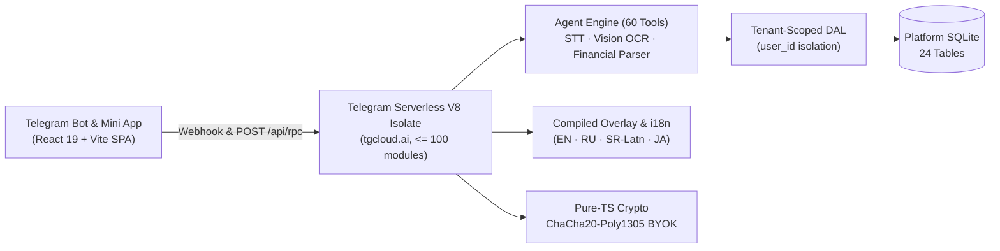

**English** | [Русский](README.ru.md) | [Srpski](README.sr.md) | [日本語](README.ja.md)

# Tokio

[](LICENSE)
[](tsconfig.json)
[](https://tgcloud.ai/)
[](src/lib/db/tables.ts)
[](miniapp/)
[](locales/)
[](tests/)

**Tokio** is an open-source personal AI assistant core engineered natively for **Telegram Serverless** (`tgcloud.ai`). It runs inside V8 isolates on an embedded 24-table SQLite database, ships a 5-tab **React 19 Telegram Mini App**, supports **4 languages out of the box** (`EN`, `RU`, `SR-Latn`, `JA`), and separates reusable core mechanics from instance personality through **declarative Level 1 Overlays**.

> [!TIP]
> **Works immediately on clone:** If you do not provide a private `overlay/` folder, Tokio automatically falls back to [`example/overlay/`](example/overlay/) and builds a complete working assistant with a localized starter demo seed ([`example/seed/demo.json`](example/seed/demo.json)).

---

## Architecture



### How It Works in Plain Terms

1. **One Serverless Isolate for Everything (`tgcloud.ai`)**: No VPS, Docker, or external DB server — the bot, Mini App static bundle (`miniapp-dist/`), and SQLite database run inside a single V8 isolate (91 TS modules, < 50 ms response).
2. **Two User Entry Points (Chat + Mini App)**: The chat bot handles text, voice notes, and receipt photos (19 commands and a 2-layer keyboard), while the **React 19 Telegram Mini App** (5 tabs, 4 locales) calls the exact same backend via `POST /api/rpc` with `initData` HMAC verification.
3. **Tool-Calling Agent (`runAgent`, 60 Tools + Skills)**: Records simple expenses and tasks right away, queries live numbers for deep questions, transcribes voice (`stt.ts`), reads receipt photos (`vision.ts`), guards destructive writes (`Write-Gate`), and respects a 26s soft deadline with live progress (`⏳ Thinking…`).
4. **Embedded Multi-Tenant SQLite (24 Tables)**: Every user's data is strictly isolated by `user_id` across tasks (`tasks`), accounts/expenses/debts & FX rates (`accounts`, `transactions`, `liabilities`, `fx_rates`), 5-column Kanban notes (`notes`), settings, and Lazy Cron reminders (`users`, `kv`, `due_jobs`).
5. **Models & Keys ($2 Trial Pool + BYOK)**: New users start immediately on the shared $2 pool, and personal API keys (**Gemini, OpenAI, DeepSeek, or Anthropic**) entered in the Mini App are encrypted inside the isolate using **ChaCha20-Poly1305**.
6. **Shared `core/` + Swappable Overlay**: The neutral engine stays identical across instances, while branding, URLs, trial limits, access flags (`publicOpenAccess`), and runtime `.md` skills live in an overlay folder (`public-overlay/` or private `overlay/`). Pushing to `ValDagon/tokio` `main` runs CI tests and deploys automatically to `<app>.tgcloud.ai`.



For full runtime and module details, see [`docs/system/ARCHITECTURE.md`](docs/system/ARCHITECTURE.md) and [`docs/system/OVERLAY-SPEC.md`](docs/system/OVERLAY-SPEC.md).

---

## Core Highlights

- **Single-Source SQLite Schema (`24` Tables)**: Defined once in [`src/lib/db/tables.ts`](src/lib/db/tables.ts), compiled to platform DSL (`src/schema.ts`) for `tgcloud migrate` and SQL DDL (`src/lib/db/ddl.ts`) for local Vitest suites.
- **Declarative Level 1 Overlays & Runtime Skills**: Keep personal prompts, persona styles, runtime `skills/*.md`, account aliases, feature flags, and Mini App themes cleanly separated in `overlay/` (gitignored) or `OVERLAY_DIR`. See [`example/README.md`](example/README.md).
- **4-Locale Support (`EN`, `RU`, `SR-Latn`, `JA`)**: Localized bot replies, keyboards, onboarding wizard, prompts, Mini App UI, and starter demo seed (`locales/*.json` + `miniapp/src/i18n/`).
- **60 Native Agent Tools**: Modular toolset covering tasks & recurring calendar events (`item_type: 'task' | 'event'`), multicurrency finances & debt queues, omnivorous Second Brain notes & knowledge graph, medications, runway forecasting, triage, diary, runtime skills (`list_skills`, `read_skill`, `draft_skill`), and soft-delete trash.
- **Deterministic Financial Parser & Rollback**: Parses expenses, income, transfers, and multi-account balances across text, voice STT, and receipt/balance photos with one-tap `[Undo]` / `/undo`.
- **Pure-TS ChaCha20-Poly1305 BYOK Encryption**: Zero native C++ dependencies; users can bring their own encrypted API keys (`Gemini`, `OpenAI`, `DeepSeek`, `Anthropic`) while honoring optional instance spend limits and open or fail-closed whitelist access modes.
- **3-Layer Leak Protection**: Private `overlay/` and `.forbidden-strings.local` are gitignored, `.githooks/pre-push` + `scripts/check-leaks.mjs` scan files and git history, and GitHub Actions runs `gitleaks` + leak checks on every push and pull request.

---

## Quick Start

### Prerequisites

- **Node.js 22+** and `npm`
- Optional: `gitleaks` (`brew install gitleaks`) for local pre-push secret scanning
- Optional: `@tgcloud/cli` token from BotFather (`Serverless -> CLI Access`) for deployment

### 1. Clone and Install

```bash
git clone https://github.com/ValDagon/tokio.git
cd tokio
npm install
(cd miniapp && npm install)
```

`npm install` configures `git config core.hooksPath .githooks` so the pre-push leak check runs automatically before pushing.

### 2. Verify Locally (Zero-Config Fallback)

Without creating any private files, Tokio compiles [`example/overlay/`](example/overlay/) and runs all checks against an in-memory SQLite engine:

```bash
npm run check:leaks
npm run typecheck
npm test
npm run build

cd miniapp
npm run lint
npm test
npm run build -- --outDir ../miniapp-dist --emptyOutDir
```

### 3. Deploy to Telegram Serverless (`tgcloud.ai`)

```bash
npx tgcloud push && npx tgcloud migrate --yes
```

Or use the verification and deployment script:

```bash
APP_URL=https://<your-app>.tgcloud.ai ./.agents/scripts/deploy.sh
```

---

## Customizing with Overlays

To customize branding, prompts, financial defaults, or feature flags without modifying core source files:

1. Copy the starter overlay into the gitignored `overlay/` directory:
   ```bash
   cp -R example/overlay overlay
   ```
2. Edit `overlay/manifest.json` and `overlay/prompts/{ru,en,sr,ja}/*.md`.
3. Rebuild and deploy (`npm run build`, or point `OVERLAY_DIR=/path/to/overlay` at any external directory).

Full walkthrough: [`example/README.md`](example/README.md) · [`docs/system/OVERLAY-SPEC.md`](docs/system/OVERLAY-SPEC.md).

---

## Contributing, Security & License

- **Contributing**: See [`CONTRIBUTING.md`](CONTRIBUTING.md) and [`AGENTS.md`](AGENTS.md) for the Core vs. Overlay boundary rule and verification checklist.
- **Security**: Please report vulnerabilities privately via [GitHub Security Advisories](https://github.com/ValDagon/tokio/security/advisories). See [`SECURITY.md`](SECURITY.md).
- **Authors & Contributors**: See [`CONTRIBUTORS.md`](CONTRIBUTORS.md) and [`NOTICE`](NOTICE).
- **License**: Licensed under the [Apache License, Version 2.0](LICENSE).
