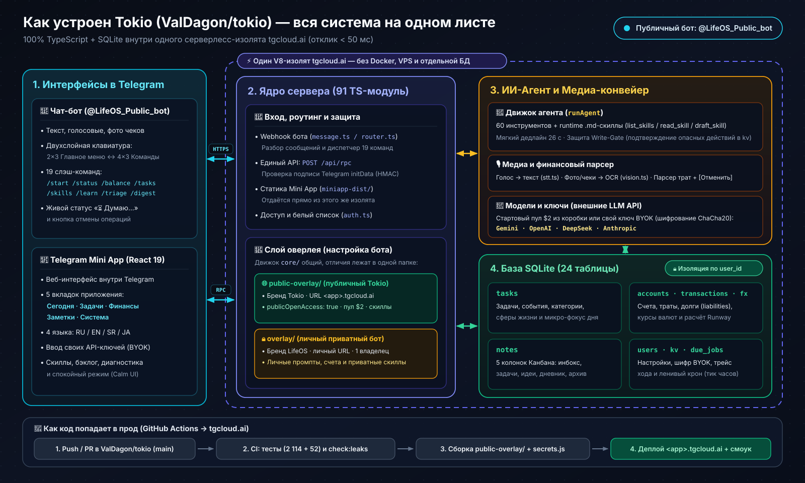
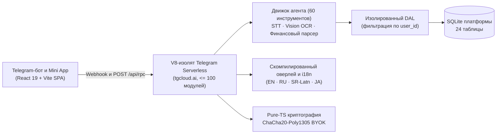

[English](README.md) | **Русский** | [Srpski](README.sr.md) | [日本語](README.ja.md)

# Tokio

[](LICENSE)
[](tsconfig.json)
[](https://tgcloud.ai/)
[](src/lib/db/tables.ts)
[](miniapp/)
[](locales/)
[](tests/)

**Tokio** — открытое ядро персонального ИИ-ассистента, созданное специально под **Telegram Serverless** (`tgcloud.ai`). Бот работает внутри V8-изолятов поверх встроенной базы SQLite из 24 таблиц, поставляется с **Telegram Mini App на React 19** (5 вкладок), поддерживает **4 языка из коробки** (`EN`, `RU`, `SR-Latn`, `JA`) и отделяет нейтральные механизмы ядра от персональных настроек с помощью **декларативных оверлеев Уровня 1**.

> [!TIP]
> **Работает сразу после клонирования:** если папка `overlay/` не создана, Tokio автоматически использует встроенный [`example/overlay/`](example/overlay/) и собирает полностью рабочего ассистента с локализованным демо-набором ([`example/seed/demo.json`](example/seed/demo.json)).

---

## Архитектура



### Как всё устроено простыми словами

1. **Всё крутится в одном серверлесс-контейнере (`tgcloud.ai`)**: нет ни VPS, ни Docker, ни отдельного сервера для базы или фронта — бот, веб-приложение (`miniapp-dist/`) и SQLite живут внутри одного V8-изолята (91 TS-модуль, отклик < 50 мс).
2. **Два входа для пользователя — Чат и Mini App**: чат-бот принимает текст, голосовые и фото чеков (19 команд и двухслойная клавиатура), а **Telegram Mini App** (React 19, 5 вкладок на 4 языках) ходит в тот же бэкенд через единый `POST /api/rpc` с проверкой подписи `initData` (HMAC).
3. **Умный агент (`runAgent`, 60 инструментов + скиллы)**: простые траты и задачи записывает сразу, на сложные вопросы поднимает факты из базы, распознаёт голос (`stt.ts`) и фото чеков (`vision.ts`), страхует удаление подтверждением (`Write-Gate`) и держит мягкий дедлайн 26 с с живым статусом `⏳ Думаю…`.
4. **Своя ячейка в SQLite (24 таблицы)**: все пользователи жёстко изолированы по `user_id` — задачи (`tasks`), счета/траты/долги и курсы валют (`accounts`, `transactions`, `liabilities`, `fx_rates`), 5 колонок заметок (`notes`), настройки и ленивый крон напоминаний (`users`, `kv`, `due_jobs`).
5. **Ключи и нейросети (стартовый пул \$2 + BYOK)**: новички сразу общаются на общем пуле (лимит \$2 на человека), а свой ключ (**Gemini, OpenAI, DeepSeek или Anthropic**) в Mini App шифруется внутри изолята по **ChaCha20-Poly1305**.
6. **Общее ядро `core/` и папка оверлея**: нейтральный движок один на все инстансы, а бренд, URL, стартовый лимит, режим доступа (`publicOpenAccess`) и `.md`-скиллы задаются в папке оверлея (`public-overlay/` или приватный `overlay/`). Пуш в `main` репозитория `ValDagon/tokio` автоматически прогоняет тесты и выкатывает обновление на `<app>.tgcloud.ai`.



Подробное описание рантайма и модулей приведено в [`docs/system/ARCHITECTURE.md`](docs/system/ARCHITECTURE.md) и [`docs/system/OVERLAY-SPEC.md`](docs/system/OVERLAY-SPEC.md).

---

## Ключевые возможности

- **Единый источник схемы SQLite (`24` таблицы)**: описана один раз в [`src/lib/db/tables.ts`](src/lib/db/tables.ts), компилируется в DSL платформы (`src/schema.ts`) для `tgcloud migrate` и в SQL DDL (`src/lib/db/ddl.ts`) для локальных тестов Vitest.
- **Декларативные оверлеи Уровня 1 и runtime-скиллы**: персональные промпты, стили общения, процедурные `skills/*.md`, алиасы счетов, флаги возможностей и темы Mini App вынесены в игнорируемую git папку `overlay/` или внешний `OVERLAY_DIR`. Подробнее: [`example/README.ru.md`](example/README.ru.md).
- **Поддержка 4 языков (`EN`, `RU`, `SR-Latn`, `JA`)**: локализованы ответы бота, клавиатуры, мастер знакомства, промпты, интерфейс Mini App и стартовый демо-набор (`locales/*.json` + `miniapp/src/i18n/`).
- **60 нативных инструментов агента**: задачи и календарные события (`item_type: 'task' | 'event'`), мультивалютные финансы и очереди обязательств, заметки Второго мозга и граф знаний, аптечка, прогноз runway, разбор инбокса, дневник, runtime-скиллы (`list_skills`, `read_skill`, `draft_skill`) и корзина.
- **Детерминированный финансовый парсер и откат**: распознаёт расходы, доходы, переводы и остатки из текста, голоса (STT) и фото чеков/балансов с мгновенным откатом по кнопке или `/undo`.
- **Pure-TS шифрование ChaCha20-Poly1305 (BYOK)**: ноль нативных C++-зависимостей; пользователи могут подключать собственный зашифрованный API-ключ (`Gemini`, `OpenAI`, `DeepSeek`, `Anthropic`) поверх настраиваемых лимитов и открытого или приватного режима доступа.
- **Трёхслойная защита от утечек**: `overlay/` и `.forbidden-strings.local` в `.gitignore`, `.githooks/pre-push` + `scripts/check-leaks.mjs` проверяют файлы и историю git, а CI запускает `gitleaks` и скан на каждый push и PR.

---

## Быстрый старт

### Требования

- **Node.js 22+** и `npm`
- Опционально: `gitleaks` (`brew install gitleaks`) для локальной проверки секретов перед push
- Опционально: токен `@tgcloud/cli` из BotFather (`Serverless -> CLI Access`) для деплоя

### 1. Клонирование и установка

```bash
git clone https://github.com/ValDagon/tokio.git
cd tokio
npm install
(cd miniapp && npm install)
```

`npm install` настраивает `git config core.hooksPath .githooks`, чтобы проверка на утечки автоматически срабатывала перед каждым `git push`.

### 2. Локальная проверка (без дополнительной настройки)

Даже без приватного оверлея Tokio автоматически собирает [`example/overlay/`](example/overlay/) и прогоняет все проверки на SQLite в памяти:

```bash
npm run check:leaks
npm run typecheck
npm test
npm run build

cd miniapp
npm run lint
npm test
npm run build -- --outDir ../miniapp-dist --emptyOutDir
```

### 3. Деплой в Telegram Serverless (`tgcloud.ai`)

```bash
npx tgcloud push && npx tgcloud migrate --yes
```

Либо через скрипт верификации и выкладки:

```bash
APP_URL=https://<your-app>.tgcloud.ai ./.agents/scripts/deploy.sh
```

---

## Настройка через оверлеи

Чтобы задать собственный бренд, промпты, финансовые настройки по умолчанию или флаги функций, не изменяя ядро:

1. Скопируйте стартовый шаблон в игнорируемую папку `overlay/`:
   ```bash
   cp -R example/overlay overlay
   ```
2. Отредактируйте `overlay/manifest.json` и файлы `overlay/prompts/{ru,en,sr,ja}/*.md`.
3. Пересоберите и задеплойте проект (`npm run build` или через `OVERLAY_DIR=/path/to/overlay`).

Подробная инструкция: [`example/README.ru.md`](example/README.ru.md) · [`docs/system/OVERLAY-SPEC.md`](docs/system/OVERLAY-SPEC.md).

---

## Участие в разработке, безопасность и лицензия

- **Участие**: правила разделения Core vs. Overlay и чек-лист проверки описаны в [`CONTRIBUTING.ru.md`](CONTRIBUTING.ru.md) и [`AGENTS.md`](AGENTS.md).
- **Безопасность**: сообщайте об уязвимостях приватно через [GitHub Security Advisories](https://github.com/ValDagon/tokio/security/advisories). Подробнее в [`SECURITY.ru.md`](SECURITY.ru.md).
- **Авторы и контрибьюторы**: [`CONTRIBUTORS.md`](CONTRIBUTORS.md) и [`NOTICE`](NOTICE).
- **Лицензия**: распространяется по лицензии [Apache License, Version 2.0](LICENSE).
