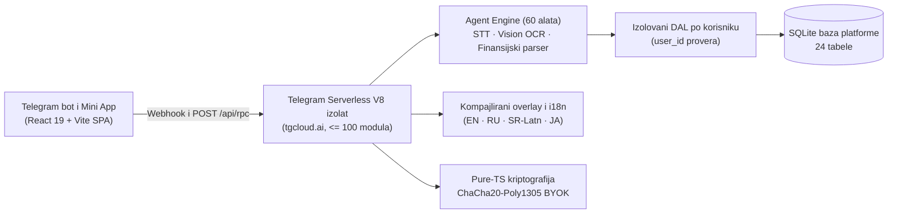

[English](README.md) | [Русский](README.ru.md) | **Srpski** | [日本語](README.ja.md)

# Tokio

[](LICENSE)
[](tsconfig.json)
[](https://tgcloud.ai/)
[](src/lib/db/tables.ts)
[](miniapp/)
[](locales/)
[](tests/)

**Tokio** je open-source jezgro ličnog AI asistenta nativno projektovano za **Telegram Serverless** (`tgcloud.ai`). Izvršava se u potpunosti unutar V8 izolata nad ugrađenom SQLite bazom od 24 tabele, uključuje **React 19 Telegram Mini App** sa 5 kartica, podržava **4 jezika od samog početka** (`EN`, `RU`, `SR-Latn`, `JA`) i razdvaja neutralnu mehaniku jezgra od lične konfiguracije putem **deklarativnih overlay paketa nivoa 1**.

> [!TIP]
> **Radi odmah nakon kloniranja:** Ako ne postoji sopstvena fascikla `overlay/`, Tokio automatski koristi ugrađeni [`example/overlay/`](example/overlay/) i gradi potpuno funkcionalnog asistenta sa lokalizovanim demo podacima ([`example/seed/demo.json`](example/seed/demo.json)).

---

## Arhitektura



Detalje o izvršnom okruženju i modulima potražite u [`docs/system/ARCHITECTURE.md`](docs/system/ARCHITECTURE.md) i [`docs/system/OVERLAY-SPEC.md`](docs/system/OVERLAY-SPEC.md).

---

## Ključne mogućnosti

- **Jedinstveni izvor SQLite šeme (`24` tabele)**: Definisana jednom u [`src/lib/db/tables.ts`](src/lib/db/tables.ts), kompajlira se u DSL platforme (`src/schema.ts`) za `tgcloud migrate` i u SQL DDL (`src/lib/db/ddl.ts`) za lokalne Vitest testove.
- **Deklarativni overlay nivoa 1 i runtime veštine**: privatni promptovi, stilovi komunikacije, runtime `skills/*.md`, alijasi računa, feature flag-ovi i Mini App teme ostaju izolovani u `.gitignore` fascikli `overlay/` ili u `OVERLAY_DIR`. Pogledajte [`example/README.sr.md`](example/README.sr.md).
- **Podrška za 4 jezika (`EN`, `RU`, `SR-Latn`, `JA`)**: Lokalizovani odgovori bota, tastature, čarobnjak za početak rada, promptovi, Mini App interfejs i početni demo podaci (`locales/*.json` + `miniapp/src/i18n/`).
- **60 nativnih alata za agenta**: Zadaci i kalendarski događaji (`item_type: 'task' | 'event'`), multivalutne finansije i liste obaveza, beleške i graf znanja, lekovi, procena runway-a, trijaža prijemnog sandučeta, dnevnik, runtime veštine (`list_skills`, `read_skill`, `draft_skill`) i korpa za vraćanje obrisanog.
- **Deterministički finansijski parser i poništavanje**: Prepoznaje troškove, prihode, prenose i stanja računa iz teksta, glasovnih poruka (STT) i fotografija priznanica/stanja sa brzim poništavanjem jednim klikom ili komandom `/undo`.
- **Pure-TS ChaCha20-Poly1305 BYOK enkripcija**: Bez nativnih C++ zavisnosti; korisnici mogu dodati sopstveni šifrovani Gemini API ključ uz opcione limite potrošnje i otvoreni ili zatvoreni režim pristupa.
- **Troslojna zaštita od curenja podataka**: `overlay/` i `.forbidden-strings.local` su u `.gitignore`, `.githooks/pre-push` + `scripts/check-leaks.mjs` skeniraju fajlove i git istoriju, a GitHub Actions pokreće `gitleaks` i proveru curenja pri svakom push-u i PR-u.

---

## Brzi početak

### Preduslovi

- **Node.js 22+** i `npm`
- Opciono: `gitleaks` (`brew install gitleaks`) za lokalnu proveru tajni pre push-a
- Opciono: `@tgcloud/cli` token iz BotFather-a (`Serverless -> CLI Access`) za deployment

### 1. Kloniranje i instalacija

```bash
git clone https://github.com/ValDagon/tokio.git
cd tokio
npm install
(cd miniapp && npm install)
```

Komanda `npm install` podešava `git config core.hooksPath .githooks` kako bi se provera curenja automatski pokretala pre svakog `git push`-a.

### 2. Lokalna provera (radi bez dodatnog podešavanja)

Bez kreiranja privatnih fajlova, Tokio automatski kompajlira [`example/overlay/`](example/overlay/) i pokreće sve testove nad in-memory SQLite bazom:

```bash
npm run check:leaks
npm run typecheck
npm test
npm run build

cd miniapp
npm run lint
npm test
npm run build -- --outDir ../miniapp-dist --emptyOutDir
```

### 3. Deployment na Telegram Serverless (`tgcloud.ai`)

```bash
npx tgcloud push && npx tgcloud migrate --yes
```

Ili pomoću skripte za verifikaciju i deployment:

```bash
APP_URL=https://<your-app>.tgcloud.ai ./.agents/scripts/deploy.sh
```

---

## Prilagođavanje putem overlay-a

Da biste promenili brend, promptove, podrazumevane finansijske postavke ili feature flag-ove bez menjanja koda jezgra:

1. Kopirajte primer u `.gitignore` fasciklu `overlay/`:
   ```bash
   cp -R example/overlay overlay
   ```
2. Izmenite `overlay/manifest.json` i `overlay/prompts/{ru,en,sr,ja}/*.md`.
3. Ponovo izgradite i objavite projekat (`npm run build` ili podesite `OVERLAY_DIR=/path/to/overlay`).

Detaljno uputstvo: [`example/README.sr.md`](example/README.sr.md) · [`docs/system/OVERLAY-SPEC.md`](docs/system/OVERLAY-SPEC.md).

---

## Doprinos, bezbednost i licenca

- **Doprinos**: Pravila razdvajanja Core i Overlay slojeva i listu provera pogledajte u [`CONTRIBUTING.sr.md`](CONTRIBUTING.sr.md) i [`AGENTS.md`](AGENTS.md).
- **Bezbednost**: Ranjivosti prijavljujte privatno putem [GitHub Security Advisories](https://github.com/ValDagon/tokio/security/advisories). Detalji su u [`SECURITY.sr.md`](SECURITY.sr.md).
- **Autori i saradnici**: [`CONTRIBUTORS.md`](CONTRIBUTORS.md) i [`NOTICE`](NOTICE).
- **Licenca**: Objavljeno pod licencom [Apache License, Version 2.0](LICENSE).
